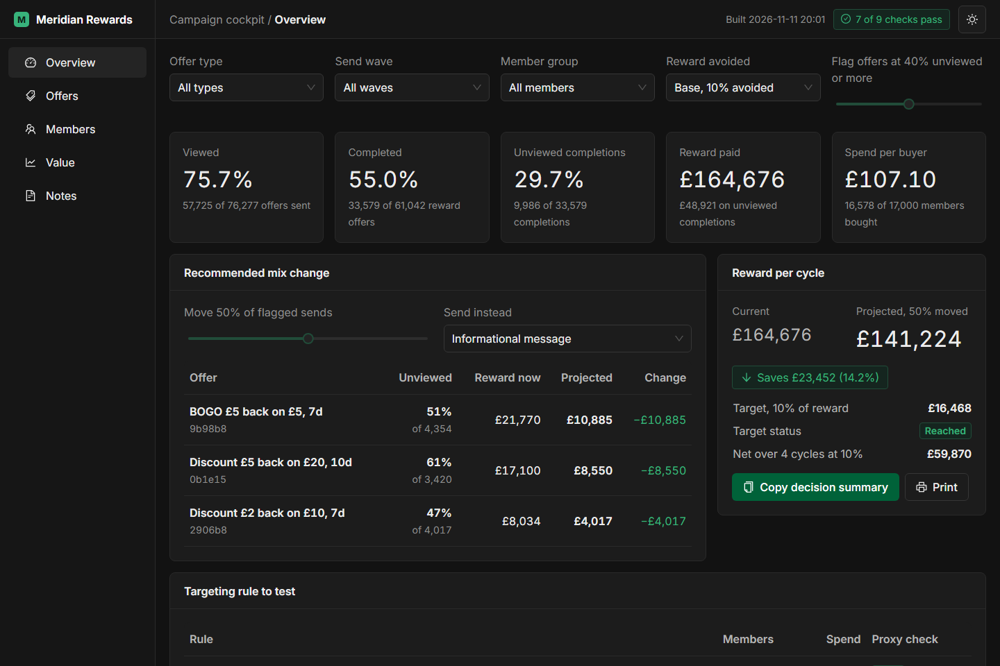
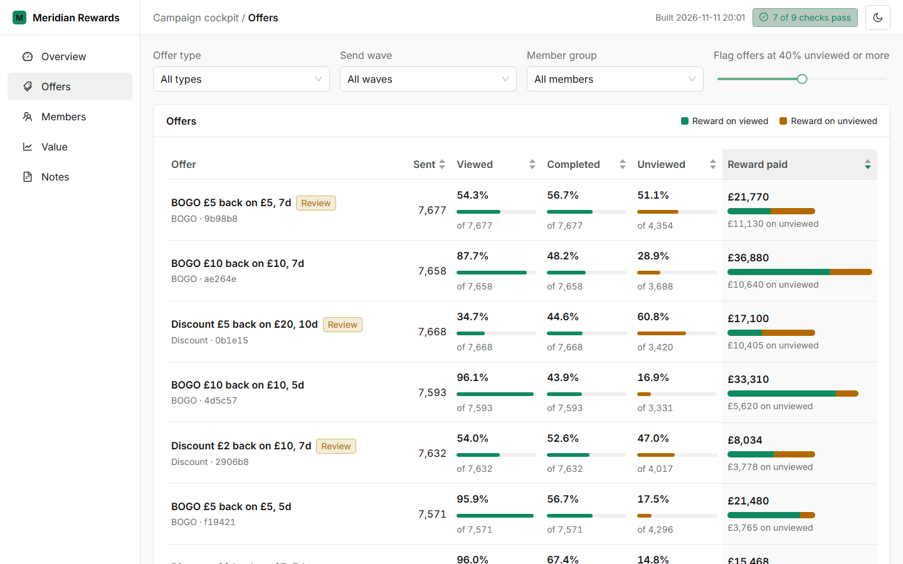
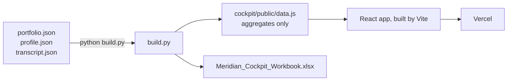

# Meridian campaign cockpit

A decision tool for the Meridian Rewards loyalty programme. It reads 306,534 programme events and tells the campaign manager which offers to stop sending before the next cycle, and what that saves.

**Live site:** https://meridian-campaign-cockpit.vercel.app
**Latest release:** [v1.0.0](https://github.com/MwangiNelson/meridian-campaign-cockpit/releases/tag/v1.0.0)



Meridian Rewards is the fictional retailer in the DSA 8404 Business Analytics practice CAT at Strathmore University. This repo is our group's answer to Option A, the campaign decision cockpit.

## What it does

At default settings the cockpit flags 3 of the 8 reward offers, because 40% or more of their completions came from members who never viewed the offer. Moving half of those sends to informational messages saves £23,452 per cycle, 14.2% of reward paid.

- Five headline numbers, each with its denominator.
- A recommended mix change with live controls, and the projected saving against a 5, 10 or 15% target.
- A plain-text decision summary, copied to the clipboard for sign-off.
- Rates per offer and per offer type, behaviour groups with daily spend, and a proxy audit that checks every targeting rule against gender.
- Net value over four cycles for Option A, which is selected, and Option B, which is deferred.
- Data checks, definitions and limits on one Notes page.
- Dark and light themes, a phone layout and print styles.
- An Excel workbook with a data dictionary, metrics, checks, an editable prioritisation matrix and scenario inputs.



## Architecture

The tool is a static site with a Python build step. There is no server, API or database.



### Build step

`build.py` is the only code that reads member-level rows. It runs once per data drop and does the following.

1. Rebuilds offer instances. Each receipt opens a window equal to the offer's duration in days times 24 hours. A view attaches to the latest receipt at or before it that has no view yet. A completion attaches to the earliest receipt that is still open.
2. Marks a completion as unviewed when that instance had no view at or before it.
3. Puts every member in one behaviour group: no purchase, buys but never completes, completes mostly unviewed, or views then completes. "Mostly" means half or more. Demographics play no part.
4. Sums a cube of offer × send wave × group. Each cell holds received, viewed, completed, unviewed, reward and unviewed reward.
5. Sums spend by send period and group, plus a daily spend series per group.
6. Runs nine data checks and a proxy audit with each group's female share, median income and median age.
7. Asserts that the cube adds back to the raw totals and exits if it doesn't.
8. Writes `cockpit/public/data.js`, a 28 KB file, and the Excel workbook.

### Front end

The app in `cockpit/` uses React 18 and Ant Design 5, bundled by Vite 5.

| File | Role |
| --- | --- |
| `index.html` | Loads `/data.js` as a plain script, then the app bundle |
| `src/lib.js` | Every calculation: filtering and summing the cube, the mix plan, the targeting rule, the decision summary. Ends with reconciliation asserts |
| `src/pages.jsx` | The five pages: Overview, Offers, Members, Value, Notes |
| `src/App.jsx` | Shell, sidebar, hash routing, filter state, theme choice |
| `src/theme.js` | Ant Design tokens for the dark and light themes |
| `src/styles.css` | Layout grids, net value bars, print rules |

Design choices worth knowing:

- `data.js` lives in `public/`, so Vite copies it unchanged. A data refresh needs a redeploy and no code change.
- The browser never sees member rows. Filters re-sum at most 240 cube rows.
- Hash routes such as `#overview` and `#offers` need no server rewrites, so any static host works.
- A rate whose denominator is under 50 shows `n<50` instead of a number.
- `?theme=dark` or `?theme=light` in the link overrides the saved and system theme. This helps on a projector.

The shape of `data.js`:

```js
window.DATA = {
  generated, rows, waves, bounds, cohorts, offers,
  cube:  [[offerId, wave, cohort, received, viewed, completed, unviewed, reward, unviewedReward], ...],
  spend: [[period, cohort, buyers, spend, transactions], ...],
  daily: { [cohort]: [spendPerDay, ...] },
  cohortMembers, totals, checks, audit,
  case: { cycles, A, B }  // business case inputs
}
```

## Running it locally

You need Node.js 18 or later; it has been tested on Node 24. The committed `data.js` lets you run the dashboard without the raw data.

```bash
git clone https://github.com/MwangiNelson/meridian-campaign-cockpit.git
cd meridian-campaign-cockpit/cockpit
npm install
npm run dev          # http://localhost:5173
```

`npm run build` writes the production site to `cockpit/dist`, and `npm run preview` serves it.

### Rebuilding from the raw data

The three case files are course material, so they are not in this repo. If you have them, put `portfolio.json`, `profile.json` and `transcript.json` in the repo root beside `build.py`, then:

```bash
pip install openpyxl
python build.py
```

It prints the totals and each check, then rewrites `cockpit/public/data.js` and `Meridian_Cockpit_Workbook.xlsx`. If the totals don't reconcile it stops with an assertion error and writes nothing. Tested on Python 3.14.

## Deployment

The live site runs on Vercel. `cockpit/vercel.json` sets the framework to Vite, the build command to `npm run build` and the output folder to `dist`.

To deploy from the command line:

```bash
cd cockpit
npx vercel deploy --prod
```

To deploy on every push, import this repo in Vercel and set Root Directory to `cockpit`.

Any other static host works as well. Run `npm run build` and serve `cockpit/dist`.

## Data and privacy

- Raw member files stay on the build machine and are git-ignored.
- `data.js` and the workbook hold aggregates only. The only IDs in them are the 10 offer IDs.
- Demographics appear only in the proxy audit, never as a filter or a targeting input.

## Limits

The tool reports association, not cause. There is no control group, and transactions carry no offer ID, so it cannot show that an offer drove a purchase. Every saving assumes members keep buying when a reward stops. A random 10% holdout on the old mix in cycle 1 is there to test that. The Notes page in the app lists every assumption and data check.

## Repository layout

```
build.py                         data pipeline and workbook writer
Meridian_Cockpit_Workbook.xlsx   generated workbook
PRODUCT.md, DESIGN.md            product context and design rules
docs/                            screenshots
cockpit/                         the web app
  index.html
  public/data.js                 generated aggregates
  src/                           App, pages, calculations, theme, styles
  vercel.json
```
